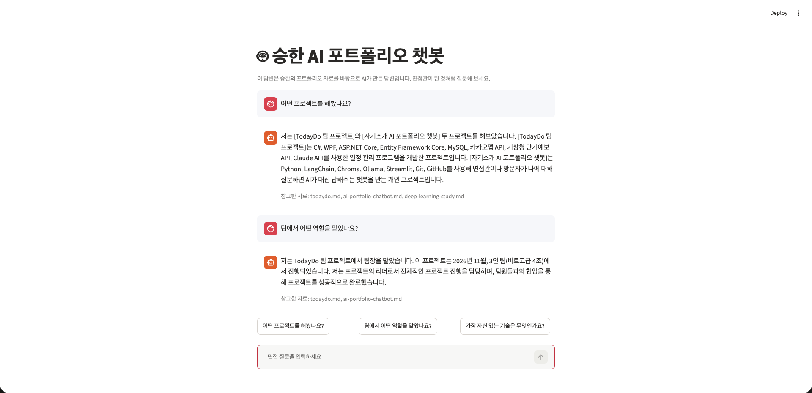

# 🤖 자기소개 AI 포트폴리오 챗봇

면접관이나 방문자가 저에 대해 질문하면, 제 포트폴리오 자료에서 관련 내용을 찾아(RAG)
AI가 면접 답변처럼 대신 답해주는 챗봇입니다.



## ✨ 주요 기능

- **RAG 기반 답변:** 질문과 비슷한 자료 조각을 벡터 DB에서 찾아 답변에 사용
- **면접 답변 스타일:** 결론 → 근거(프로젝트, 기술, 역할) → 배운 점 순서로 답변
- **지어내지 않는 답변:** 자료에 없는 내용은 "해당 내용은 자료에 없습니다."라고 답변
- **출처 표시:** 답변마다 참고한 자료 파일 이름을 표시
- **추천 질문 버튼:** 자주 묻는 면접 질문을 버튼으로 바로 질문
- **비용 0원:** Ollama로 내 컴퓨터에서 AI를 실행해서 자료가 외부로 나가지 않음

## 🛠 기술 스택

| 구분 | 기술 |
|---|---|
| 언어 | Python 3.12 |
| RAG | LangChain, Chroma (벡터 DB) |
| AI 모델 | Ollama - qwen2.5:3b (답변), bge-m3 (임베딩, 한국어 지원) |
| 화면 | Streamlit |
| 버전 관리 | Git, GitHub |

## 🧭 동작 구조

```
data 폴더의 자료(.md)
   ↓ ingest.py: 500글자 조각으로 나누고 숫자(벡터)로 바꿔 저장
Chroma 벡터 DB
   ↓ rag.py: 질문과 비슷한 조각 4개를 찾고, 그 조각만 보고 AI가 답변
Streamlit 채팅 화면 (app.py)
```

| 파일 | 역할 |
|---|---|
| `config.py` | 모델 이름, 폴더 이름 등 설정 |
| `ingest.py` | 자료를 조각내서 벡터 DB에 저장 |
| `rag.py` | 관련 조각 검색 + 면접 답변 생성 |
| `app.py` | 채팅 화면 |
| `data/` | 챗봇이 읽는 자료 |

## 🚀 실행 방법 (macOS 기준)

**1. Ollama 설치 후 모델 받기**

[ollama.com](https://ollama.com)에서 Ollama를 설치하고 실행한 뒤:

```bash
ollama pull qwen2.5:3b
ollama pull bge-m3
```

**2. 프로젝트 받기와 설치**

```bash
git clone https://github.com/seunghani119/ai-portfolio-chatbot.git
cd ai-portfolio-chatbot
python3.12 -m venv .venv
source .venv/bin/activate
pip install -r requirements.txt
```

**3. 설정 파일 만들기**

```bash
cp .env.example .env
```

**4. 벡터 DB 만들고 실행**

```bash
python ingest.py
streamlit run app.py
```

브라우저에서 `http://localhost:8501`이 열립니다.

## 🙋 내 자료로 쓰는 방법

이 챗봇은 자료만 바꾸면 누구나 자기 포트폴리오 챗봇으로 쓸 수 있습니다.

1. `data/projects` 폴더의 파일을 지우고, 내 프로젝트 자료를 `.md` 파일로 넣습니다.
   - 파일 첫 줄은 `# 제목`, 내용은 `## 소제목`으로 나눠 쓰면 검색이 잘 됩니다.
2. `.env` 파일의 `OWNER_NAME`을 내 이름으로 바꿉니다.
3. `python ingest.py`를 다시 실행합니다.

## 📌 한계와 앞으로 개선할 점

- 내 컴퓨터에서만 실행되어 링크로 접속할 수 없음 → Gemini로 바꿔서 웹 배포 예정
- 앞 질문을 기억하지 못해 이어서 묻는 질문은 잘 이해하지 못함 → 대화 기억 기능 추가 예정
- 화면에서 파일을 올릴 수 없음 → 파일 업로드 기능 추가 예정
- 작은 모델(3b)이라 한국어 문장이 가끔 어색할 수 있음

## 👤 만든 사람

- 이승한 (Seunghan) · [GitHub](https://github.com/seunghani119)